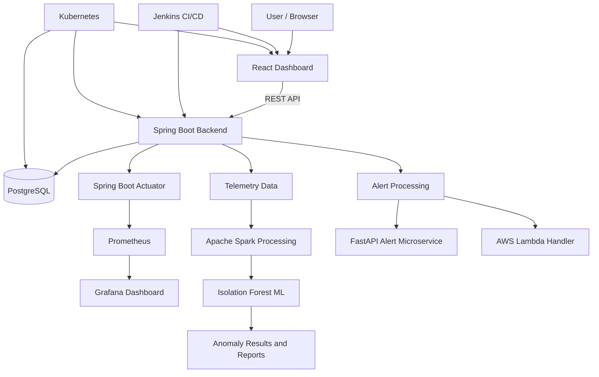
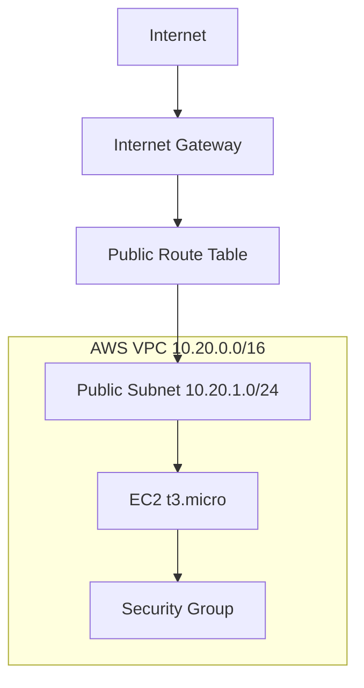
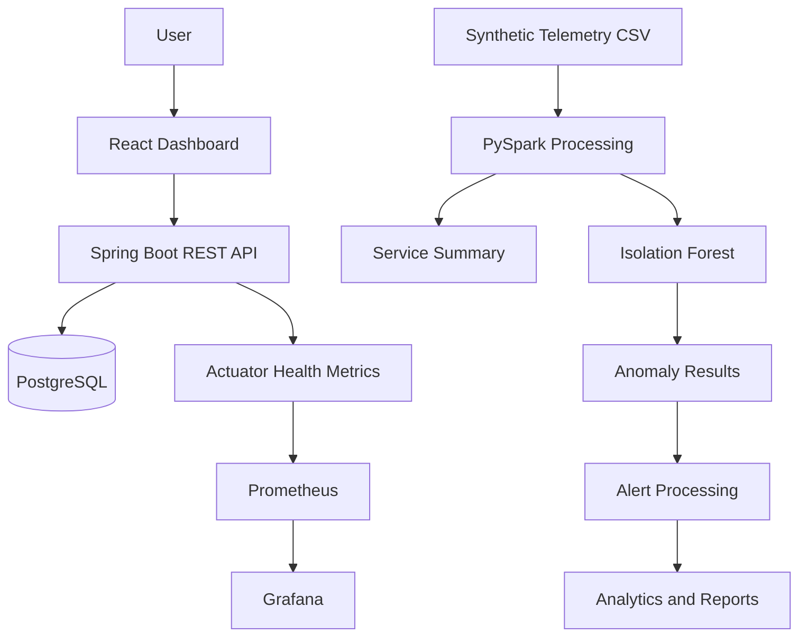

# CloudOps Enterprise Platform
## Complete Cloud Architecture and Infrastructure Document

## 1. Project Overview

CloudOps Enterprise Platform is a cloud operations and monitoring solution designed to provide application health information, service metrics, deployment visibility, infrastructure monitoring and telemetry analysis.

The platform combines a web dashboard, REST APIs, persistent storage, containerization, CI/CD automation, Kubernetes deployment assets, monitoring tools, infrastructure-as-code and a Big Data/ML analytics pipeline.

## 2. Technology Stack

| Layer | Technology |
|---|---|
| Frontend | React 19, TypeScript, Vite |
| Backend | Java 17, Spring Boot 3.5.7 |
| API | REST |
| Database | PostgreSQL 16 |
| ORM | Spring Data JPA, Hibernate |
| Containerization | Docker |
| Local orchestration | Docker Compose |
| Container orchestration | Kubernetes |
| CI/CD | Jenkins |
| Infrastructure as Code | Terraform |
| Cloud provider | AWS |
| Monitoring | Prometheus, Grafana |
| Application health | Spring Boot Actuator |
| Big Data processing | Apache Spark / PySpark |
| Data processing | Python, Pandas, NumPy |
| Machine Learning | Scikit-learn, Isolation Forest |
| Alert microservice | Python, FastAPI |
| Serverless component | Python Lambda-compatible handler |

## 3. High-Level System Architecture



This diagram represents the logical architecture and integration points. Deployment status of individual components is explained in the following sections.

## 4. Application Architecture

### 4.1 Frontend

The React and TypeScript frontend provides the user interface for application monitoring and cloud operations.

Responsibilities:
- Display application and dashboard metrics.
- Present service and deployment information.
- Communicate with backend REST APIs.
- Provide dashboard navigation and monitoring views.

### 4.2 Backend

The backend is developed using Java 17 and Spring Boot.

Responsibilities:
- Expose REST API endpoints.
- Process dashboard and service requests.
- Manage application data.
- Communicate with PostgreSQL through Spring Data JPA and Hibernate.
- Expose health information using Spring Boot Actuator.

### 4.3 Database

PostgreSQL 16 is used for persistent application data.

- Database port: 5432.
- Backend application port: 8080.
- Docker volume: cloudops_postgres_data.
- Database credentials should be supplied through environment variables.

## 5. API Architecture

| Method | Endpoint | Purpose |
|---|---|---|
| GET | /api/dashboard/summary | Retrieve dashboard metrics |
| GET | /api/services | List services |
| GET | /api/deployments | List deployments |
| POST | /api/services | Add a service |
| POST | /api/deployments | Add a deployment |
| GET | /actuator/health | Application health status |

The frontend communicates with the backend using HTTP REST requests.

## 6. Cloud Infrastructure and VM Setup

### 6.1 Existing AWS Deployment

An existing application deployment is available on an AWS EC2 instance.

- Cloud provider: Amazon Web Services.
- Region: ap-south-1 (Mumbai).
- Application access: http://3.109.48.131

This is the existing application deployment. Its configuration should not be confused with the separate Terraform infrastructure definition described below.

### 6.2 Terraform Infrastructure Configuration

The Terraform configuration in `infrastructure/main.tf` describes an AWS infrastructure design with:

| Resource | Configuration |
|---|---|
| AWS region | ap-south-1 |
| VPC | 10.20.0.0/16 |
| Public subnet | 10.20.1.0/24 |
| Internet access | Internet Gateway |
| Routing | Public route table |
| Compute | EC2 t3.micro |
| Storage | 8 GB gp3 |
| AMI | Latest Amazon Linux 2023 image |
| Security group | HTTP ingress on port 80 |
| Instance access | IAM role for Systems Manager |
| Metadata | IMDSv2 required |

The Terraform configuration is infrastructure-as-code evidence. It is not confirmation that these resources were applied to create the currently running EC2 application. Terraform state and deployment should be verified independently before provisioning.

### 6.3 Network Layout



The configured security group permits HTTP traffic on port 80 and outbound traffic. Production use should further restrict ingress and administrative access.

## 7. Containerization and Kubernetes

Docker is used to package application components into reproducible container images.

Project container assets include:
- `frontend/Dockerfile`
- `frontend/nginx.conf`
- `backend/cloudops-backend/Dockerfile`
- `backend/cloudops-backend/compose.yaml`

The Kubernetes configuration is maintained in:

`kubernetes/cloudops.yaml`

The Kubernetes environment has been tested using Docker Desktop. Frontend, backend and PostgreSQL workloads have been verified running in the local cluster.

Important deployment distinction:
- Docker Desktop Kubernetes is the verified local orchestration environment.
- The project does not claim an EKS deployment.
- Kubernetes manifests are included as deployment assets.

## 8. CI/CD Pipeline

Jenkins is used to automate the application build workflow.

The pipeline includes:
1. Source-code checkout.
2. Frontend dependency installation and production build.
3. Backend Maven build.
4. Backend Docker image build.

The Jenkins job is named `CloudOps-Enterprise-Pipeline`.

A successful Jenkins build has been captured as submission evidence. The current pipeline builds the backend Docker image; it should not be described as a fully automated production deployment pipeline.

## 9. Monitoring and Observability

### Prometheus

Prometheus collects application monitoring metrics and evaluates alert rules.

Configuration:
- `monitoring/prometheus.yml`
- `monitoring/alert_rules.yml`

Configured alert:
- Name: CloudOpsBackendDown
- Expression: `up{job="cloudops-backend"} == 0`
- Evaluation duration: 1 minute
- Severity: critical

### Grafana

Grafana provides monitoring dashboards and visualization of available metrics.

The submitted evidence includes Prometheus target health and Grafana dashboard screenshots.

Some panels may display no data when their underlying metric is not currently being collected. Monitoring evidence should therefore be interpreted according to the captured target and panel status.

## 10. Microservices and Serverless Components

### 10.1 Alert Processing Microservice

A separate Python FastAPI alert service is maintained in:

`microservices/alert-service/`

It includes:
- FastAPI application.
- Alert-processing logic.
- Python dependency file.
- Dockerfile.

This component provides a separately packaged alert-processing service.

### 10.2 Serverless Alert Handler

A Python Lambda-compatible handler is maintained in:

`lambda/`

It contains:
- Shared alert-processing logic.
- Event handler implementation.

Unit tests validate normal telemetry, high-risk telemetry, missing fields and Lambda handler behaviour.

The new alert microservice and Lambda handler have been locally tested. They are not represented as deployed AWS Lambda or production microservice endpoints.

## 11. Big Data and Machine Learning Pipeline

A telemetry analytics pipeline is maintained in `data-ml/`.

### Data Generation

- Generates 50,000 synthetic cloud telemetry records.
- Includes CPU usage, memory usage, API latency, requests per minute and error rate.
- Covers four simulated services.

### Big Data Processing

Apache Spark processes the telemetry dataset using local execution.

- Reads generated CSV telemetry.
- Cleans and deduplicates records.
- Aggregates service-level statistics.
- Exports summary results.

### Machine Learning

An Isolation Forest model is used for anomaly detection.

The workflow includes:
1. Feature preparation.
2. Robust scaling.
3. Isolation Forest training and prediction.
4. Anomaly result export.
5. Model performance evaluation.
6. Graph generation.

### Experimental Results

| Metric | Result |
|---|---:|
| Total records | 50,000 |
| Actual synthetic anomalies | 2,029 |
| Detected anomalies | 2,000 |
| Precision | 1.0000 |
| Recall | 0.9857 |
| F1 score | 0.9928 |

These results are from a controlled synthetic dataset with generated anomaly labels. They demonstrate the pipeline and model workflow, not production incident prediction accuracy.

Generated outputs include:
- `data-ml/output/spark_summary.json`
- `data-ml/output/ml_summary.json`
- `data-ml/output/anomaly_results.csv`
- `data-ml/graphs/anomaly_distribution.png`
- `data-ml/graphs/cpu_usage_distribution.png`
- `data-ml/graphs/ml_confusion_matrix.png`

## 12. Data Flow



## 13. Security Model

Security measures and design considerations include:

- Environment variables for application and database configuration.
- No production credentials should be committed to source control.
- IAM role-based access for the Terraform EC2 design.
- IMDSv2 requirement in the Terraform EC2 configuration.
- Security group ingress rules for controlled network access.
- Database persistence through a Docker volume.
- Application health endpoints for service monitoring.
- Production deployment should use HTTPS, least-privilege IAM policies, restricted administrative access and managed secrets.
- Terraform state files must remain private and must not be committed to Git.

## 14. Repository Structure

```text
CloudOps-Enterprise-Platform/
├── frontend/
├── backend/
├── infrastructure/
├── kubernetes/
├── monitoring/
├── microservices/
│   └── alert-service/
├── lambda/
├── data-ml/
│   ├── data/
│   ├── graphs/
│   ├── output/
│   └── scripts/
├── tests/
├── documentation/
└── submission/
    └── evidence/
```

## 15. Verification and Implementation Status

| Component | Status |
|---|---|
| React frontend build | Verified |
| Spring Boot backend | Verified |
| PostgreSQL integration | Verified |
| Docker application assets | Available |
| Docker Compose | Existing local configuration |
| Terraform infrastructure code | Available |
| Existing AWS EC2 application | Deployed |
| Jenkins CI build | Successful build evidence |
| Kubernetes manifests | Available |
| Docker Desktop Kubernetes | Locally verified |
| Prometheus monitoring | Target evidence captured |
| Grafana dashboard | Evidence captured |
| FastAPI alert microservice | Locally tested |
| Lambda-compatible handler | Unit tested |
| Spark telemetry processing | Successfully executed |
| ML anomaly detection | Successfully executed |
| Production deployment of new alert components | Not yet performed |
| EKS deployment | Not claimed |

## 16. Conclusion

CloudOps Enterprise Platform combines cloud application development, infrastructure automation, containerization, CI/CD, monitoring, alert processing and telemetry analytics.

The project demonstrates an end-to-end cloud operations workflow through an existing AWS application, local Kubernetes validation, Jenkins build automation, Prometheus and Grafana monitoring, and a reproducible synthetic Big Data and ML pipeline.

The repository includes implementation code, infrastructure definitions, configuration files, analytical outputs and verification evidence to support the academic project submission.